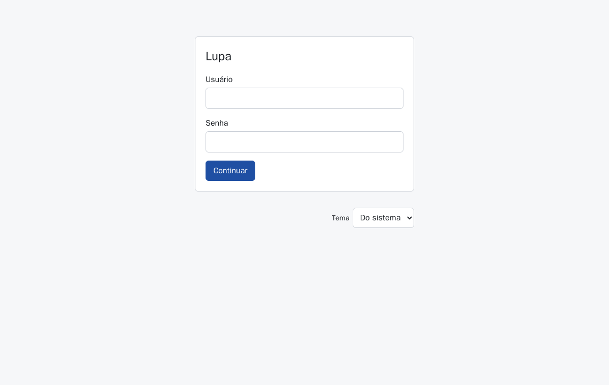
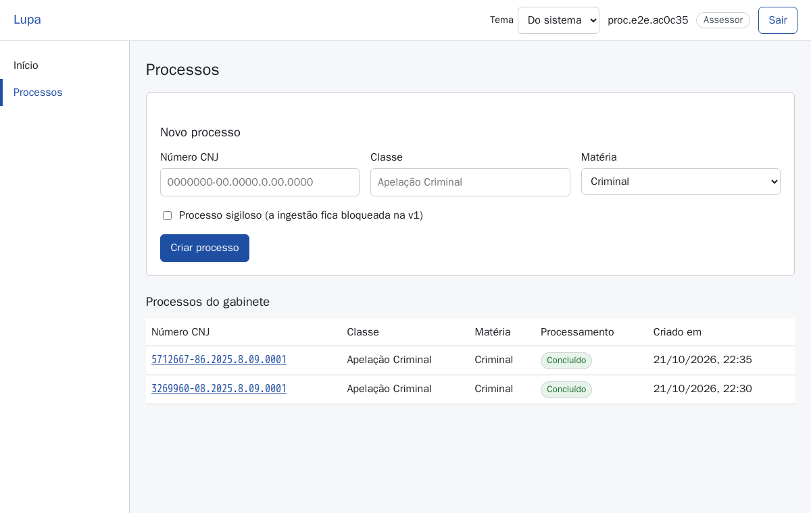
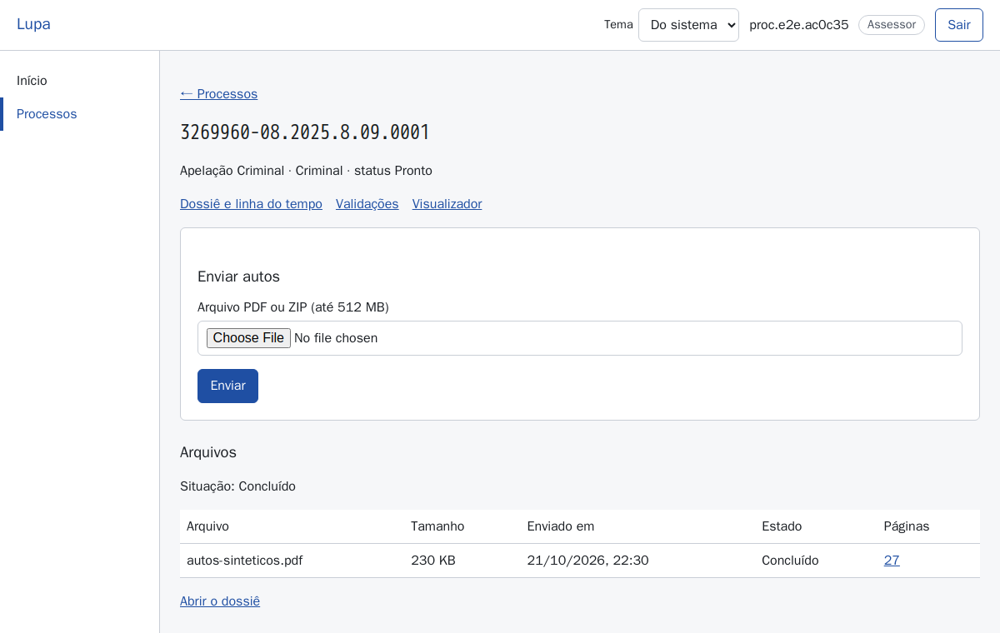
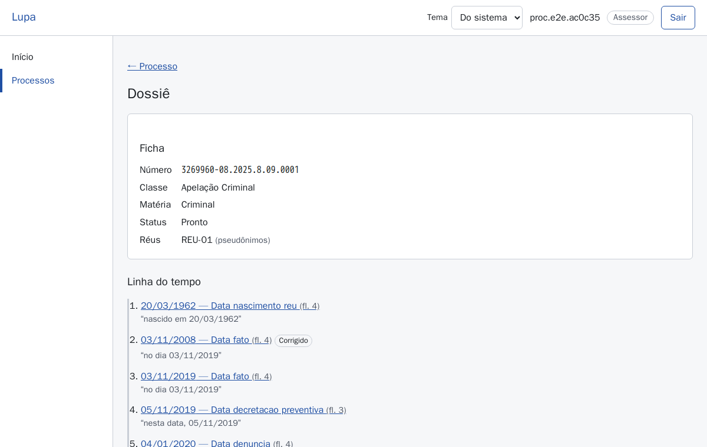
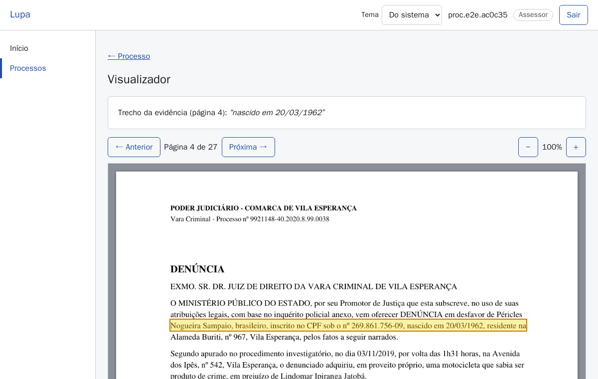
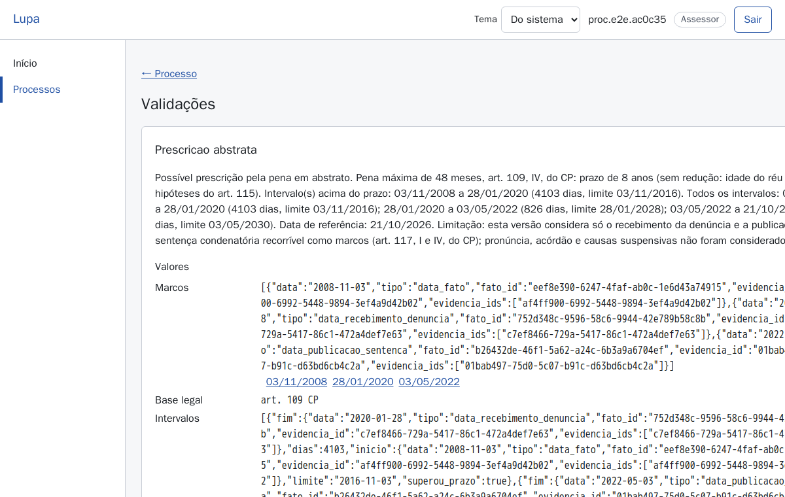
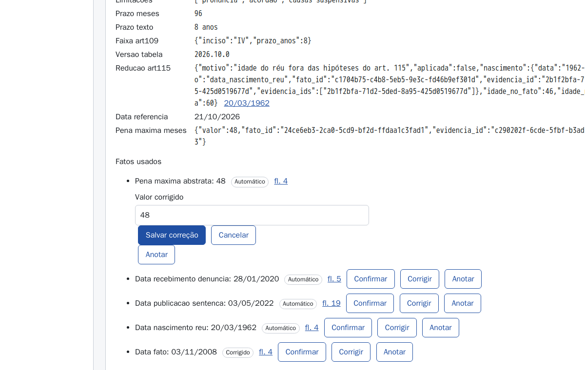
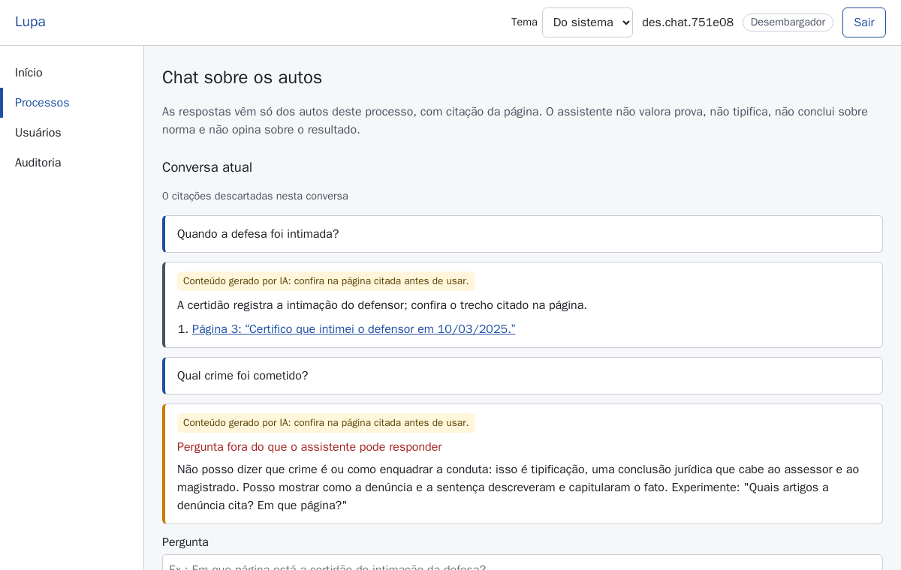

# Guia do assessor

Este guia explica, passo a passo, como usar o Lupa. Não é preciso saber nada de informática além
de usar um navegador e um aplicativo no celular. As telas mostradas aqui usam processos
**fictícios** (gerados para teste); nenhum dado real aparece nas imagens.

## 1. O que o Lupa faz e o que não faz

O Lupa é uma ferramenta de **apoio** para conferir processos criminais em 2º grau. Ele:

- recebe os autos (PDF ou ZIP exportado do Projudi) e separa em páginas e peças;
- monta a linha do tempo com as datas que encontrou, cada uma ligada à página de onde saiu;
- faz três contas automáticas: **prazo do recurso**, **prescrição pela pena máxima** e
  **revisão da prisão preventiva a cada 90 dias**;
- responde perguntas de **localização** sobre o processo, sempre com a página citada.

O Lupa **não** decide, **não** opina, **não** avalia provas, **não** diz qual crime foi cometido e
**não** escreve votos ou decisões. A conclusão é sempre sua e do desembargador. Tudo que o sistema
mostra pode ser conferido na página dos autos, e você deve conferir antes de usar.

## 2. Primeiro acesso e autenticador

Você recebe do desembargador um **nome de usuário** e uma **senha temporária**. Tenha à mão um
celular com um aplicativo autenticador (por exemplo, Google Authenticator ou Aegis; qualquer um
que gere "códigos de 6 dígitos").

1. Abra o endereço do Lupa no navegador. Na primeira vez o navegador pode avisar que o
   certificado não é confiável (piloto local); aceite a exceção só se o endereço for o que o
   desembargador passou.
2. Digite **Usuário** e **Senha** (a temporária) e clique **Continuar**.
3. Aparece **Cadastre o autenticador**, com um QR code. No aplicativo do celular, escolha
   "adicionar conta" e leia o QR code. Se a câmera não funcionar, digite a chave mostrada em
   texto abaixo do QR code.
4. O aplicativo passa a mostrar um código de 6 dígitos que muda a cada 30 segundos. Digite o
   código atual em **Código de 6 dígitos** e clique **Confirmar autenticador**.
5. O sistema pede uma senha nova: preencha **Senha atual** (a temporária), **Nova senha** e
   **Confirme a nova senha**, e clique **Salvar nova senha**. Pronto: você está dentro.

Nas próximas vezes: usuário e senha → **Continuar** → código do aplicativo → **Entrar**.

Bom saber:

- A sessão termina após **30 minutos sem uso** ou **8 horas** depois de entrar. Aparece "Sessão
  encerrada ou expirada. Entre novamente."; é só entrar de novo.
- Errou a senha várias vezes? Aparece "Muitas tentativas…". Espere alguns minutos.
- Trocou de celular ou perdeu o autenticador? Peça ao desembargador para **resetar o
  autenticador**; ele pede o cadastro de novo no próximo acesso. Esqueceu a senha? Peça para
  **resetar a senha**; você recebe outra temporária.
- O sistema não usa e-mail. Ninguém do Lupa vai pedir sua senha ou seu código.

## 3. Criar um processo e enviar os autos

1. Clique em **Processos** no menu.
2. Em **Novo processo**, preencha o **Número CNJ** (no formato 0000000-00.0000.0.00.0000; o
   sistema confere o dígito verificador e recusa número inválido), a **Classe** (ex.: Apelação
   Criminal) e a **Matéria** (Criminal). Clique **Criar processo**.
   - Processo em segredo de justiça: marque **Processo sigiloso**. Nesta versão a ingestão de
     processo sigiloso fica **bloqueada**; não envie autos sigilosos.
3. Clique no número do processo na lista. Em **Enviar autos**, escolha o arquivo em
   **Arquivo PDF ou ZIP (até 512 MB)** e clique **Enviar**. Uma barra mostra o progresso.

4. Em **Arquivos** aparece o estado do processamento, que se atualiza sozinho:
   - **Concluído**: pronto para usar;
   - **Com pendências** / parcial: algumas páginas não foram lidas; use com cuidado e confira;
   - **Em quarentena**: o arquivo foi recusado (ex.: PDF incompleto ou corrompido); o motivo
     aparece na linha. Exporte de novo do Projudi e reenvie;
   - **Falhou**: avise o desembargador (seção 12).
5. Quando terminar, use os botões **Dossiê e linha do tempo**, **Validações** e **Chat**.

## 4. O dossiê e o que cada marca significa

O dossiê é montado **sem inteligência artificial**, a partir do que foi lido nos autos:

- **Ficha**: número, classe, matéria, status e **réus**. Os réus aparecem como `REU-01`,
  `REU-02`... (pseudônimos), de propósito: o nome real não circula na parte analítica.
- **Linha do tempo**: cada data encontrada (fato, denúncia, recebimento, sentença, intimação,
  interposição, prisão...) com a folha entre parênteses, por exemplo "(fl. 12)", e o trecho
  literal dos autos entre aspas. Clique na data para abrir a página.
  - Um selo ao lado da data (por exemplo **Corrigido**) indica que alguém do gabinete corrigiu
    aquele fato; sem selo, a data foi extraída automaticamente.
- **Índice de peças**: ordem, tipo da peça (denúncia, sentença, certidão...), origem (juízo, MP,
  defesa, terceiro), páginas, data e **Confiança** (de 0% a 100%, com o método entre
  parênteses). Confiança baixa = classificação duvidosa: confira a peça.
  - **Flags**: selos de alerta da peça. "N alerta(s) de saneamento" quer dizer que alguma página
    da peça tem algo estranho (texto oculto, texto que parece instrução, página digitalizada de
    leitura ruim). Não é um defeito do processo: é um aviso para você olhar a página com atenção.
- **Gerar resumos das peças (modelo)**: opcional. O resumo aparece numa caixa marcada **GERADO**:
  foi escrito por inteligência artificial e precisa ser conferido.
- **Alertas de saneamento**: lista de páginas sinalizadas, com link para cada uma.
- **Achados**: resumo das três contas (detalhes na seção 6).

## 5. Abrir o visualizador por uma evidência

Tudo que tem página no Lupa é clicável: a data na linha do tempo, o intervalo de páginas no
índice, o link de evidência nas validações e a citação no chat. O clique abre o **Visualizador**
na página certa, com o trecho usado **destacado** (caixa colorida) e o texto do trecho em
**Trecho da evidência**.

- Use os botões ou as setas do teclado (com a página selecionada) para ir à página anterior ou
  seguinte, e os botões de zoom para ampliar.
- Se aparecer "Esta página não tem coordenadas de texto; o trecho não pôde ser destacado", a
  página é digitalizada: leia o trecho mostrado e procure-o na imagem.
- **Conferir sempre:** o trecho destacado diz mesmo o que o sistema afirma? A data é a do ato
  certo (por exemplo, a intimação do réu e não a do MP)?

## 6. Ler um alerta de validação e refazer a conta à mão

Na tela **Validações**, cada conta vira um **achado** com um de três resultados:

| Resultado | Significa |
| --- | --- |
| **Conforme** | a conta não encontrou problema |
| **Atenção** | a conta encontrou um possível problema |
| **Verificar** | o sistema não conseguiu concluir: falta uma data, há duas datas diferentes para a mesma coisa ou houve erro. O texto diz o que falta |

Cada achado mostra **Valores** (prazo aplicado, datas, feriados e suspensões considerados),
**Fatos usados** (cada data com o link **evidência** para a página) e a **Explicação**, um texto
de modelo fixo (não é inteligência artificial). A **data de referência** que aparece nos Valores
é a data em que a conta foi feita (normalmente o dia em que a ingestão terminou ou em que um fato
foi corrigido); é até ela que se mede o último intervalo da prescrição e da preventiva. Para conferir: abra cada evidência, veja se a
data está certa, e refaça a conta com um calendário como nos exemplos abaixo.

### 6.1 Prazo do recurso (tempestividade)

Regras usadas: apelação e recurso em sentido estrito têm 5 dias; embargos de declaração, 2 dias.
Se a defesa recorre, conta-se da **última** intimação entre réu e defensor. Não se conta o dia da
intimação; conta-se o último dia. Dias corridos. Se o último dia cair em sábado, domingo, feriado
ou suspensão de prazo (recesso), passa para o próximo dia útil.

**Exemplo:** apelação da defesa. Defensor intimado em **segunda, 08/09/2025**; réu intimado em
**quarta, 10/09/2025**.

1. Última intimação: 10/09/2025 (a do réu).
2. Não conta o dia 10. Dia 1 = 11/09, dia 2 = 12/09, dia 3 = 13/09, dia 4 = 14/09,
   dia 5 = **15/09/2025** (segunda-feira, dia útil).
3. Apelação interposta em 15/09 ou antes: **Conforme**. Interposta em **16/09/2025**: **Atenção**,
   1 dia depois do prazo.
4. Se o dia 5 caísse num sábado, o vencimento iria para a segunda seguinte (ou para o primeiro
   dia útil, se a segunda fosse feriado).

O que o sistema **não** confere e você precisa ver: se a certidão de intimação é válida (pessoal,
edital, réu preso); se o recurso é mesmo o indicado; feriados e suspensões do tribunal (compare a
lista do achado com o calendário oficial do TJGO, que no piloto ainda é provisório); a regra da
**intimação na sexta-feira** (pela Súmula 310 do STF, se a intimação é numa sexta, o prazo só
começa a correr na segunda-feira seguinte, ou no próximo dia útil; o sistema conta a partir do
sábado, então em intimação de sexta o vencimento real pode ser **um ou mais dias depois** do que o
sistema mostra; refaça a conta com a segunda como **dia 1**. Exemplo: réu intimado na sexta 12/09/2025; o
sistema mostra vencimento em 17/09 (dia 1 = sábado 13/09); pela súmula, dia 1 = segunda 15/09 e o
dia 5 = **sexta 19/09/2025**); e prazos especiais (Juizado, Lei de Drogas, ECA, assistente de acusação), que o
sistema não aplica.

### 6.2 Prescrição pela pena máxima

Regras usadas: a pena máxima do crime define o prazo pela tabela:

| Pena máxima | Prazo |
| --- | --- |
| acima de 12 anos | 20 anos |
| acima de 8 até 12 anos | 16 anos |
| acima de 4 até 8 anos | 12 anos |
| acima de 2 até 4 anos | 8 anos |
| de 1 até 2 anos | 4 anos |
| abaixo de 1 ano | 3 anos |

O prazo cai **pela metade** se o réu tinha menos de 21 anos na data do fato ou 70 anos ou mais na
data da sentença. O sistema mede cada intervalo entre marcos: **fato → recebimento da
denúncia**, **recebimento → publicação da sentença condenatória** e **último marco → data de
referência**. Se a data final de um intervalo passa da data inicial somada ao prazo: **Atenção**.

**Exemplo:** pena máxima de 4 anos (48 meses) → prazo de **8 anos**. Réu maior de 21 no fato.

1. Fato em 10/02/2014; recebimento da denúncia em 20/03/2015. 10/02/2014 + 8 anos = 10/02/2022;
   20/03/2015 é antes: intervalo OK.
2. Recebimento em 20/03/2015; sentença publicada em 15/05/2023. 20/03/2015 + 8 anos =
   **20/03/2023**; 15/05/2023 é **depois**: **Atenção** (intervalo de mais de 8 anos).
3. Se o réu tivesse 19 anos na data do fato, o prazo seria de 4 anos e o primeiro intervalo
   (1 ano e 1 mês) continuaria OK; o segundo, com mais razão, daria Atenção.

O sistema **não** considera: pronúncia, acórdão condenatório, causas que suspendem a prescrição,
prescrição retroativa, intercorrente e executória, concurso de crimes e aumentos ou diminuições
que mudam a pena máxima. Confira a pena máxima, cada marco nos autos e a idade do réu.
Intervalo **exatamente igual** ao prazo é tratado como não prescrito; essa regra ainda depende de
confirmação do gabinete.

### 6.3 Revisão da prisão preventiva a cada 90 dias

Regra usada: põem-se em ordem a data da decretação e as datas das decisões que revisaram a
prisão; mede-se cada intervalo, e o último vai até a data de referência. Intervalo **acima de 90
dias**: **Atenção**, com a indicação de qual.

**Exemplo:** preventiva decretada em 10/01/2025; revisões em 05/04/2025 e 15/07/2025.

1. 10/01 → 05/04: 21 dias (11 a 31/01) + 28 (fevereiro) + 31 (março) + 5 (abril) = **85 dias**:
   OK.
2. 05/04 → 15/07: 25 dias (06 a 30/04) + 31 (maio) + 30 (junho) + 15 (julho) = **101 dias**:
   **Atenção** (passou de 90).
3. O último intervalo vai da última revisão (15/07/2025) até a data de referência; se ela fosse
   20/10/2025, seriam 16 + 31 + 30 + 20 = 97 dias: também **Atenção**.
4. Sem nenhuma revisão, mede-se só da decretação até a data de referência.
5. Intervalo de exatamente 90 dias hoje é tratado como **Conforme** (regra ainda a confirmar pelo
   gabinete; o mesmo vale para a prescrição com intervalo exatamente igual ao prazo, tratada hoje
   como não prescrita).

Confira: se cada decisão listada como revisão de fato reexaminou a necessidade da prisão; se o
réu continua preso; se houve soltura e nova prisão no meio (o sistema não sabe disso).

## 7. Confirmar ou corrigir um fato

Se a data (ou outro valor) usada num achado está errada:

1. Em **Validações**, no achado, ache o fato errado e clique **Corrigir**.
2. Digite o valor certo em **Valor corrigido** (data no formato pedido) e clique
   **Salvar correção**.
3. O que acontece: o Lupa **não apaga** o fato original. Ele grava um fato novo, ligado ao antigo,
   com o selo **Corrigido**; o antigo vai para **Fatos substituídos**. As três contas são
   **refeitas** com o valor novo, e os achados anteriores ficam em **Histórico** / **Achados
   anteriores**, para qualquer um ver o antes e o depois.
4. Se a data estava certa, não precisa fazer nada; se quiser deixar registrado que conferiu,
   use **Anotar** no achado (ex.: "Conferi a certidão da fl. 12"), depois **Salvar anotação**.

A correção é sua responsabilidade: abra a página e confira antes de corrigir. Toda correção fica
registrada com seu usuário.

## 8. Usar o chat

Abra **Chat** no processo. Escreva em **Pergunta** e clique **Perguntar**. Cada conversa é sobre
**um único processo**.

**Perguntas que funcionam** (localizar, extrair, resumir, relacionar): "Em que página está a
sentença?", "Quando a defesa foi intimada?", "Quais eventos entre a denúncia e a sentença?",
"Resuma a denúncia", "Explique o achado de prescrição".

**O que o chat recusa, e por quê:** a ferramenta segue as regras do CNJ para uso de inteligência
artificial pelo Judiciário, que permitem usá-la para localizar, organizar e resumir, mas não
para tarefas de alto risco como avaliar provas, enquadrar fatos juridicamente ou concluir sobre
a aplicação de leis e precedentes. Por isso o chat responde "Não posso…" e sugere uma pergunta
permitida ("Experimente: …") quando você pede para:

- avaliar prova ("a testemunha é confiável?", "a prova basta?");
- dizer qual é o crime ou se há qualificadora;
- concluir sobre lei, súmula ou nulidade;
- opinar sobre o resultado ("o recurso deve ser provido?", "qual a pena justa?");
- redigir voto, decisão, ementa ou despacho;
- calcular prazo ou prescrição "de cabeça" (as contas só vêm da ferramenta de validação).

**Como ler a resposta:**

- Toda resposta vem num bloco com o aviso **conteúdo gerado por IA**.
- **Citações**: cada "Página N" é um link. Clique e confira no visualizador se o trecho está lá
  e diz o que a resposta afirma. O sistema já conferiu automaticamente que o trecho existe na
  página; citação que não confere é **descartada** e aparece o aviso "N citação(ões)
  descartada(s) nesta resposta". Muitos descartes = desconfie da resposta.
- **Sem citação válida** ("sem evidência"): a resposta não tem nenhuma citação conferida. Trate
  como **não confirmada** e procure você mesmo nos autos.
- **Resposta descartada pela conferência automática**: o sistema achou algo suspeito (por exemplo,
  texto que parece instrução escondida nos autos ou referência a outro processo) e não mostrou a
  resposta.
- **Processo em revisão**: depois de um incidente desses, o chat do processo fica suspenso
  ("Processo em revisão.") até o desembargador conferir e clicar **Liberar revisão**. O dossiê e
  as validações continuam disponíveis. Avise o desembargador.
- **Limite de uso**: conversas longas têm limite; ao atingir, a conversa é encerrada e vai para
  **Conversas anteriores**. A próxima pergunta abre conversa nova.

## 9. O que fica registrado e quem vê

O Lupa registra **quem fez o quê, quando e de onde**: entrar e sair (inclusive tentativas
erradas), abrir processo, ver página, buscar, perguntar no chat, anotar, corrigir fato, enviar
autos, contas executadas, chamadas ao modelo de IA e mudanças de conta. Guarda também o IP e a
cidade aproximada.

**Nunca** registra: texto dos autos, texto das suas perguntas e das respostas, texto das
anotações, senhas ou códigos do autenticador. Fica só "fulano perguntou algo no processo X às
14h03".

**Quem vê:** o desembargador vê a auditoria do próprio gabinete; o administrador do sistema vê
todos os gabinetes, e qualquer acesso dele ao conteúdo de autos aparece em destaque na auditoria
do gabinete. Assessores não veem a auditoria. Ninguém consegue apagar ou alterar um registro: o
sistema detecta qualquer alteração.

## 10. Pedir reclassificação de peça

Nesta versão não há botão de reclassificar na tela. Se uma peça está com o tipo ou a origem
errados no índice (ex.: certidão marcada como sentença), ou se duas peças foram unidas ou
separadas no lugar errado:

1. Anote o **número do processo**, a **ordem da peça** no índice, as **páginas** e o **tipo
   correto** (e a origem, se for o caso).
2. Envie esses dados ao desembargador por escrito (pelo canal interno do gabinete), que pede ao administrador do sistema a correção. A correção grava uma
   versão nova da peça, ligada à antiga (nada é apagado), e fica registrada na auditoria.
3. Enquanto isso, se a peça errada afetou uma data num achado, corrija o fato (seção 7).

## 11. O que fazer quando algo parece errado

| Situação | O que fazer |
| --- | --- |
| Data errada num achado ou na linha do tempo | Abra a evidência, confira e **Corrigir** o fato (seção 7) |
| Achado "Verificar" | Leia o que falta; procure a data nos autos; se existir, corrija/inclua pelo fato indicado ou anote |
| Peça com tipo errado | Peça reclassificação (seção 10) |
| Resposta do chat sem evidência ou com descartes | Não use; procure nos autos você mesmo |
| Chat suspenso ("Processo em revisão") | Avise o desembargador |
| Arquivo em quarentena ou com pendências | Reexporte do Projudi e reenvie; persistindo, avise o desembargador |
| Algo estranho na tela, texto esquisito nos autos, acesso que você não fez | Não clique em links do texto dos autos (o Lupa nunca cria links a partir do texto); avise o desembargador, que pode conferir a auditoria |
| Esqueceu senha ou perdeu o celular | Peça reset ao desembargador |

Em qualquer dúvida, a regra é a mesma: **a página dos autos vale mais que o sistema**.

## 12. Limitações conhecidas

- Só três contas automáticas, e só criminais; não há validações cíveis nem de mérito (teses,
  fundamentação, bis in idem).
- As contas não conhecem prazos especiais, causas suspensivas da prescrição, pronúncia, acórdão,
  soltura e nova prisão, nem a regra da intimação na sexta-feira (seção 6).
- O calendário de feriados do TJGO está **provisório** no piloto; confira sempre os feriados
  listados no achado.
- Processos em segredo de justiça não podem ser processados nesta versão.
- Páginas digitalizadas passam por leitura automática (OCR) que pode errar; o destaque pode não
  aparecer nelas.
- O chat responde só sobre o processo aberto, não pesquisa jurisprudência e pode errar: confira
  cada citação.
- Não há exportação de relatório do processo para fora do sistema.
