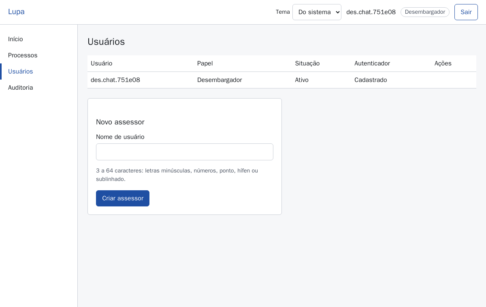
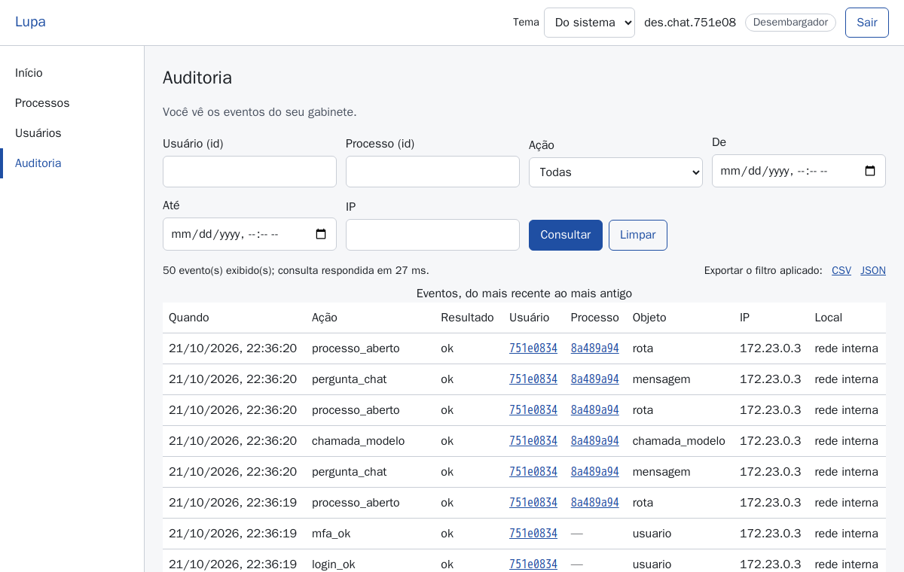
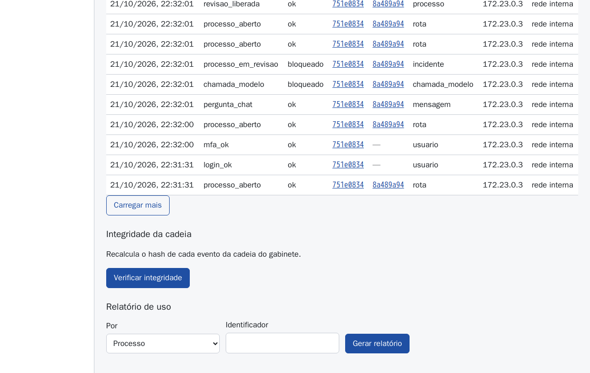

# Guia do desembargador

Tudo do [guia do assessor](guia-assessor.md) vale também para o senhor: o desembargador vê e
faz tudo o que o assessor faz. Este guia trata só do que é **exclusivo** do desembargador. As
telas usam dados **fictícios** de teste.

## 1. Gestão de assessores

Menu **Usuários**. A tabela mostra cada pessoa do gabinete com **Papel**, **Situação** (ativo ou
desativado) e **Autenticador** (cadastrado ou pendente).

**Adicionar um assessor**

1. Em **Novo assessor**, digite o **Nome de usuário** (3 a 64 caracteres: letras minúsculas,
   números, ponto, hífen ou sublinhado) e clique **Criar assessor**.
2. O sistema mostra uma **senha temporária**, que **não será exibida de novo**. Anote e entregue
   pessoalmente ao assessor (nunca por e-mail ou mensagem junto com o nome de usuário). Clique
   **Já anotei, fechar**.
3. No primeiro acesso o assessor cadastra o autenticador e troca a senha (guia do assessor,
   seção 2).

**Desativar** (quando o assessor sai do gabinete): botão **Desativar** na linha; confirme na
janela que abre (Esc ou **Cancelar** desistem). A pessoa perde o acesso na hora. O histórico dela
na auditoria **não é apagado**. **Reativar** devolve o acesso.

## 2. Reset de senha e do autenticador

- **Resetar senha**: gera nova senha temporária (mostrada uma única vez, como na criação). O
  assessor entra com ela e é obrigado a trocar.
- **Resetar autenticador**: apaga o cadastro do autenticador. No próximo acesso o assessor lê um
  QR code novo (use quando trocar ou perder o celular).
- Antes de resetar, confirme por um canal seguro (pessoalmente ou por telefone conhecido) que o
  pedido é mesmo do assessor. Todo reset fica registrado na auditoria com o seu usuário.
- A sua própria senha ou autenticador: peça ao administrador do sistema.

## 3. Liberar processo em revisão

Quando o chat detecta algo suspeito numa resposta (por exemplo, texto nos autos que parece uma
instrução escondida para a IA, ou menção a outro processo), ele descarta a resposta e coloca o
processo **em revisão**: o chat daquele processo fica suspenso para todos ("Processo em revisão.").
Dossiê e validações continuam funcionando.

1. Abra o **Chat** do processo. Aparece o aviso e o botão **Liberar revisão**.
2. Antes de liberar, veja na **Auditoria** o evento `processo_em_revisao` (escolha esse valor na lista **Ação** e clique **Consultar**; a linha mostra
   quando, quem perguntou e o processo) e
   olhe no dossiê os **Alertas de saneamento** das páginas do processo: há texto estranho? O
   arquivo é mesmo o exportado do Projudi?
3. Se estiver tudo em ordem, clique **Liberar revisão** e confirme em **Liberar**. Fica
   registrado o evento `revisao_liberada` com seu usuário. Se não estiver, mantenha suspenso e
   avise o administrador.

## 4. Auditoria do gabinete

Menu **Auditoria**. O senhor vê só o próprio gabinete.

- **Filtros**: **Usuário (id)**, **Processo (id)**, **Ação** (ex.: `login_falha`,
  `processo_aberto`, `pergunta_chat`, `fato_corrigido`, `admin_acesso_conteudo`), período (**De**,
  **Até**) e **IP**. Clique **Consultar**; **Carregar mais** traz eventos mais antigos.
- Cada linha: quando, ação, resultado (`ok`, `falha`, `negado`, `bloqueado`), usuário, processo,
  objeto, IP e local aproximado. Clicar no usuário ou no processo abre o relatório de uso dele.
- **O que nunca aparece**: texto dos autos, das perguntas, das respostas e das anotações; senhas.
- **Acesso do administrador** a conteúdo de autos aparece como `admin_acesso_conteudo`: filtre
  por essa ação para ver quando e o quê.
- **Exportar o filtro aplicado**: **CSV** ou **JSON**. A exportação também vira um registro.
- **Integridade da cadeia**: o botão **Verificar integridade** recalcula o lacre de cada evento.
  "Íntegra" quer dizer que ninguém alterou nem apagou registro. Se acusar problema, ele mostra o
  primeiro evento afetado: avise o administrador imediatamente e guarde uma exportação.

## 5. Relatório de uso

Na mesma tela, seção **Relatório de uso**: escolha **Por** (processo ou usuário), cole o
**Identificador** (ou clique num id na tabela) e gere. Mostra quantas vezes cada ação ocorreu,
primeiro e último acesso, quais versões do modelo de IA e das instruções foram usadas, e um
**custo estimado** (estimativa pela tabela de preços do sistema; o valor real está na fatura do
fornecedor). Exporte em CSV/JSON pelo filtro da auditoria se precisar anexar.

## 6. Dever de informar o tribunal

O Lupa é uma ferramenta **privada** de inteligência artificial generativa, fornecida por terceiro
(não é do tribunal). As normas do CNJ sobre uso de IA pelo Judiciário (Resolução CNJ 615/2025,
art. 19, conforme o documento de requisitos do sistema; confira o texto vigente) permitem esse
uso pelo magistrado e servidores para tarefas de apoio, desde que:

- o uso fique nas finalidades de apoio (localizar, organizar, resumir), sem decisão automática;
- a supervisão e a conclusão sejam sempre humanas;
- o magistrado **informe ao tribunal** o uso da ferramenta, na forma que o tribunal definir.

O **relatório de uso** por processo e por usuário existe para isso: ele mostra o que foi usado,
por quem, quando e com qual versão do modelo, sem expor o conteúdo dos autos. Combine com o
tribunal a periodicidade e o formato da comunicação e guarde as exportações enviadas.

Outros cuidados que dependem do senhor:

- Não envie autos de processos em segredo de justiça (bloqueados nesta versão).
- Garanta que os assessores leram o guia e sabem que **toda informação deve ser conferida na
  página dos autos**.
- Desative imediatamente o acesso de quem deixar o gabinete.
