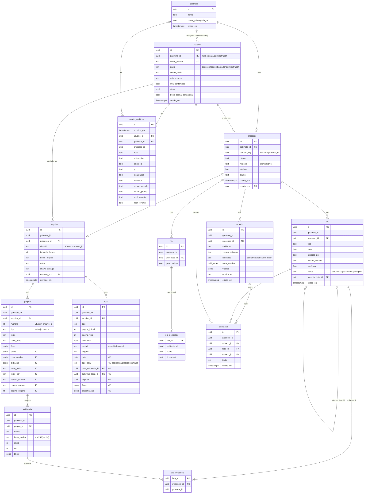

# Modelo de dados (Etapa 1)

Fonte da verdade: `src/lupa/dominio/tabelas.py` (SQLAlchemy) e `src/lupa/dominio/esquemas.py`
(pydantic). A migração `src/lupa/migrations/esquema_v0001.py` é escrita à mão e o teste
`test_migracao_coincide_com_tabelas` garante que ela produz o mesmo esquema das tabelas.

## Diagrama

Toda tabela marcada com `gabinete_id` tem Row Level Security. As setas para `processo`, `arquivo`,
`pagina`, `fato`, `evidencia`, `reu` e `achado` são chaves estrangeiras compostas
`(x_id, gabinete_id)`, o que impede um filho de apontar para um pai de outro gabinete.



## Regras impostas pelo banco

| Regra | Mecanismo |
| --- | --- |
| Fato sem evidência | `CONSTRAINT TRIGGER fato_exige_evidencia` (adiado para o commit) em `fato`, e `fato_evidencia_nao_orfa` ao apagar a última associação |
| Achado imutável | `BEFORE UPDATE` com `lupa_bloquear_update()` em `achado` |
| Arquivo imutável | o mesmo trigger em `arquivo` |
| Valores de enum | `CHECK <coluna> IN (...)` gerado de `lupa.dominio.enums` (texto + CHECK, para estender sem `ALTER TYPE`) |
| `pagina_final >= pagina_inicial`, `fim > inicio >= 0`, `confianca` em [0, 1], anotação com um único alvo, só administrador sem gabinete | `CHECK` |
| Filho no mesmo gabinete do pai | FKs compostas `(x_id, gabinete_id)` |
| Índices | `(gabinete_id)` em toda tabela com o campo; `(processo_id, tipo)` em `fato`; únicos `(arquivo_id, numero)` em `pagina`, `(processo_id, sha256)` em `arquivo`, `(gabinete_id, numero_cnj)` em `processo` |

Nome real de pessoa só existe em `reu_identidade.nome` e em `usuario` (credenciais).
`gabinete.nome` é nome de órgão, não de pessoa.

## Row Level Security

Toda tabela com `gabinete_id` tem `ENABLE` e `FORCE ROW LEVEL SECURITY` e a política
`<tabela>_por_gabinete`:

```sql
USING      (gabinete_id = NULLIF(current_setting('lupa.gabinete_id', true), '')::uuid)
WITH CHECK (gabinete_id = NULLIF(current_setting('lupa.gabinete_id', true), '')::uuid)
```

Sem a variável definida nenhuma linha é visível. Superusuários e donos com `BYPASSRLS` ignoram RLS
no PostgreSQL; por isso a migração cria o papel `lupa_app` (`NOLOGIN`, só DML) e a aplicação deve
operar sob ele.

### Como a API define a variável por requisição

1. A dependência de sessão do FastAPI abre uma transação por requisição.
2. Depois de autenticar o usuário (Etapa 3), chama, dentro dessa transação:
   - `lupa.dominio.sessao.assumir_papel_aplicacao(session)` → `SET LOCAL ROLE lupa_app`
     (desnecessário quando a conexão já é feita com um usuário de login membro de `lupa_app`, que é o
     caminho recomendado para produção);
   - `lupa.dominio.sessao.definir_gabinete(session, usuario.gabinete_id)` →
     `set_config('lupa.gabinete_id', '<uuid>', true)`.
3. Ambos valem só até o fim da transação (`SET LOCAL`/`is_local = true`), então a conexão volta ao
   pool sem gabinete definido e não vaza para a próxima requisição.

O acesso do administrador a vários gabinetes (gabinete nulo) fica para a Etapa 3; hoje ele não vê
nada sob `lupa_app`.

## Revisão 0004 (Etapa 4C)

`pagina` ganha `sinais`, `coordenadas`, `extracao` (rota, OCR, divergência, tempo), `texto_nativo`,
`texto_ocr`, `versao_extrator`, `origem_arquivo` e `pagina_origem`; `job_ingestao` ganha
`relatorio` e `versao_extrator`; `diagnostico_arquivo` ganha `fronteiras_origem`, e o CHECK de
`cenario` aceita `pdf_com_bookmarks_e_indice`. Detalhes em `docs/ingestao.md`.

## Revisão 0006 (Etapa 4E)

`pagina` ganha `sinais_fronteira` (JSON). `peca` ganha `data`, `tipo_data` (CHECK:
`assinatura`, `protocolo`, `juntada`), `data_evidencia_id` (FK composta para `evidencia`, com o
literal da data, offsets e hash), `substitui_peca_id` (FK composta para a própria `peca`, que
passa a ter UNIQUE `(id, gabinete_id)`), `vigente` (padrão verdadeiro), `flags` e
`classificacao` (JSON), e o índice `(arquivo_id, vigente)`. A reclassificação manual nunca
altera a classificação de uma linha: grava linha nova `metodo = manual` que aponta a anterior e
só desliga `vigente` na anterior; o índice e a origem por trecho (4D.8) leem só as vigentes.

## Migrações

```bash
docker compose exec api alembic -c src/lupa/migrations/alembic.ini upgrade head
docker compose exec api alembic -c src/lupa/migrations/alembic.ini downgrade base
```

A URL vem de `LUPA_DATABASE_URL`. O `alembic.ini` da raiz aponta para a mesma pasta, para uso fora
do contêiner. O `downgrade` remove tabelas e funções, mas mantém o papel `lupa_app`, que é global ao
cluster e pode estar em uso por outro database (por exemplo, o de testes).
